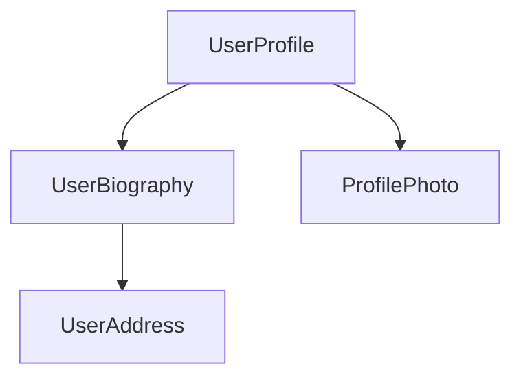

<docs-decorative-header title="কম্পোনেন্ট" imgSrc="adev/src/assets/images/components.svg"> <!-- markdownlint-disable-line -->
Angular-এ অ্যাপ্লিকেশন তৈরির মৌলিক গাঠনিক উপাদান।
</docs-decorative-header>

কম্পোনেন্ট হলো Angular অ্যাপ্লিকেশনের প্রধান গাঠনিক উপাদান। প্রতিটি কম্পোনেন্ট একটি বড় ওয়েব পেজের একটি অংশকে উপস্থাপন করে। অ্যাপ্লিকেশনকে কম্পোনেন্টে ভাগ করে সাজালে প্রজেক্টে একটি সুগঠিত কাঠামো আসে — কোড স্পষ্টভাবে নির্দিষ্ট অংশে বিভক্ত থাকে, যা রক্ষণাবেক্ষণ করা এবং সময়ের সঙ্গে বড় করা সহজ।

## কম্পোনেন্ট সংজ্ঞায়িত করা {#defining-a-component}

প্রতিটি কম্পোনেন্টের কয়েকটি প্রধান অংশ থাকে:

1. একটি `@Component` [ডেকোরেটর](https://www.typescriptlang.org/docs/handbook/decorators.html), যাতে Angular-এর ব্যবহৃত কিছু কনফিগারেশন থাকে।
2. একটি HTML টেমপ্লেট, যা DOM-এ কী রেন্ডার হবে তা নিয়ন্ত্রণ করে।
3. একটি [CSS সিলেক্টর](https://developer.mozilla.org/docs/Learn/CSS/Building_blocks/Selectors), যা HTML-এ কম্পোনেন্টটি কীভাবে ব্যবহৃত হবে তা নির্ধারণ করে।
4. একটি TypeScript ক্লাস, যাতে থাকে আচরণ — যেমন ব্যবহারকারীর ইনপুট সামলানো বা সার্ভারে রিকোয়েস্ট পাঠানো।

এখানে একটি `UserProfile` কম্পোনেন্টের সরলীকৃত উদাহরণ দেওয়া হলো।

```angular-ts {header: "user-profile.ts"}
@Component({
  selector: 'user-profile',
  template: `
    <h1>User profile</h1>
    <p>This is the user profile page</p>
  `,
})
export class UserProfile {
  /* Your component code goes here */
}
```

`@Component` ডেকোরেটর ঐচ্ছিকভাবে একটি `styles` প্রোপার্টিও নেয়, টেমপ্লেটে প্রয়োগ করতে চাওয়া যেকোনো CSS-এর জন্য:

```angular-ts {header: "user-profile.ts"}
@Component({
  selector: 'user-profile',
  template: `
    <h1>User profile</h1>
    <p>This is the user profile page</p>
  `,
  styles: `
    h1 {
      font-size: 3em;
    }
  `,
})
export class UserProfile {
  /* Your component code goes here */
}
```

### HTML ও CSS আলাদা ফাইলে ভাগ করা {#separating-html-and-css-into-separate-files}

`templateUrl` এবং `styleUrl` ব্যবহার করে আপনি কম্পোনেন্টের HTML ও CSS আলাদা ফাইলে সংজ্ঞায়িত করতে পারেন:

```angular-ts {header: "user-profile.ts"}
@Component({
  selector: 'user-profile',
  templateUrl: 'user-profile.html',
  styleUrl: 'user-profile.css',
})
export class UserProfile {
  // Component behavior is defined in here
}
```

```angular-html {header: "user-profile.html"}
<h1>User profile</h1>
<p>This is the user profile page</p>
```

```css {header: "user-profile.css"}
h1 {
  font-size: 3em;
}
```

## কম্পোনেন্টের ব্যবহার {#using-components}

একাধিক কম্পোনেন্ট একত্রে সাজিয়ে আপনি একটি অ্যাপ্লিকেশন তৈরি করেন। উদাহরণস্বরূপ, একটি ইউজার প্রোফাইল পেজ তৈরি করলে পেজটিকে আপনি এভাবে কয়েকটি কম্পোনেন্টে ভাগ করতে পারেন:



এখানে `UserProfile` কম্পোনেন্টটি চূড়ান্ত পেজ তৈরি করতে আরও কয়েকটি কম্পোনেন্ট ব্যবহার করছে।

একটি কম্পোনেন্ট ইমপোর্ট ও ব্যবহার করতে আপনাকে যা করতে হবে:

1. আপনার কম্পোনেন্টের TypeScript ফাইলে, যে কম্পোনেন্টটি ব্যবহার করতে চান তার জন্য একটি `import` স্টেটমেন্ট যোগ করুন।
2. আপনার `@Component` ডেকোরেটরে, `imports` অ্যারেতে ব্যবহার করতে চাওয়া কম্পোনেন্টটির একটি এন্ট্রি যোগ করুন।
3. আপনার কম্পোনেন্টের টেমপ্লেটে, ব্যবহার করতে চাওয়া কম্পোনেন্টটির সিলেক্টরের সঙ্গে মেলে এমন একটি এলিমেন্ট যোগ করুন।

এখানে `UserProfile` কম্পোনেন্টের একটি `ProfilePhoto` কম্পোনেন্ট ইমপোর্ট করার উদাহরণ দেওয়া হলো:

```angular-ts {header: "user-profile.ts"}
import {ProfilePhoto} from './profile-photo';

@Component({
  selector: 'user-profile',
  imports: [ProfilePhoto],
  template: `
    <h1>User profile</h1>
    <profile-photo />
    <p>This is the user profile page</p>
  `,
})
export class UserProfile {
  // Component behavior is defined in here
}
```

TIP: Angular কম্পোনেন্ট সম্পর্কে আরও জানতে চান? সম্পূর্ণ বিবরণের জন্য [কম্পোনেন্টের বিস্তারিত গাইড](guide/components) দেখুন।

## পরবর্তী ধাপ {#next-step}

Angular-এ কম্পোনেন্ট কীভাবে কাজ করে তা তো জানলেন, এবার অ্যাপ্লিকেশনে ডাইনামিক ডেটা কীভাবে যোগ ও পরিচালনা করা হয় তা শেখার সময়।

<docs-pill-row>
  <docs-pill title="সিগন্যাল দিয়ে রিঅ্যাকটিভিটি" href="essentials/signals" />
  <docs-pill title="কম্পোনেন্টের বিস্তারিত গাইড" href="guide/components" />
</docs-pill-row>
